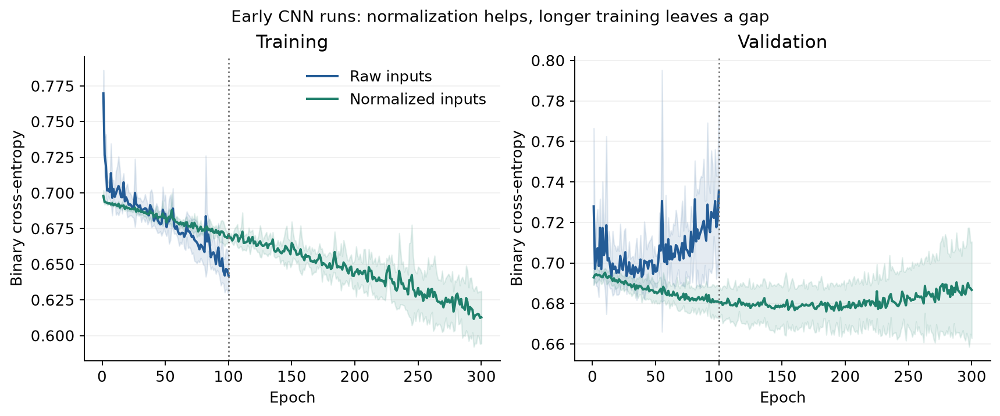
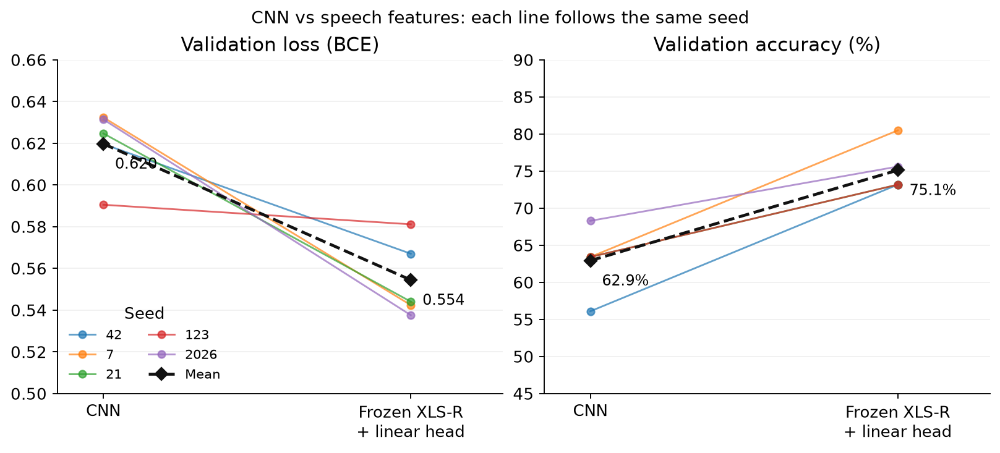

# Songsored

**In progress**

The project's still ongoing, so I'm sharing what I've learned so far here. Development happens in a private repository, and this log follows the experiments, the results, and what I'm working on next.

The idea started with something simple: I wanted to listen to rap when my parents were around without worrying about explicit lyrics coming on. Songsored is my attempt to make that possible for Moroccan rap by finding and eventually censoring selected words.

Right now, I can run a classifier that checks whether a one-second clip contains a target word. Full-song detection and censoring are still missing.

Getting the data has been a big part of the challenge. Darija speech resources exist, but I needed reliable, task-specific examples from songs, especially profanity and slurs. I ended up building a focused dataset for this task.

Speech-to-text support for Darija also doesn't guarantee reliable rap transcription. Words can be stretched, shortened, or pronounced differently in music, while instruments, overlapping voices, and Darija/French code-switching add to the difficulty. Here's what I've tried so far.

## First, I needed examples

I used lyrics and alignment models to propose word locations, then listened to clips in a local review lab. Recording-separated splits keep clips from the same song together; automatic labels stay in training.

[More on building the dataset and resolving alignment disagreements](docs/dataset-builder.md).

## First: get the CNN working

I built the log-mel features, dataset loader, small CNN, and training loop. After the tiny-subset check, I tried longer runs and compared seeds.



*189 training clips / 37 recordings; 41 validation clips / 8 other recordings. Mean and shaded sample SD across five seeds. Adam, learning rate 0.001, batch size 16.*

- I kept training-only normalization. Compare the first 100 epochs for an equal-budget view.
- Continuing to 300 epochs lowered training loss, but validation flattened and later rose. Longer training didn't remove the gap.
- Weight decay at `1e-4` and frequency masking up to 8 bands didn't give a consistent improvement in their separate trials. I kept zero decay and masking disabled.

## More data, then speech features

I expanded the dataset and checked reviewed-only versus mixed-label training. Mixed labels helped validation loss, but accuracy varied by seed. That didn't settle whether the remaining errors came from labels or the representation.

Next I cached features from frozen XLS-R-300M and trained a linear head on their time averages.



*1,297 training clips / 449 recordings; the same 41 validation clips / 8 recordings. Five seeds, 24,600 Adam updates each, batch size 16, learning rate 0.001, threshold 0.5. Training-only normalization; checkpoints selected by lowest validation BCE. Equal updates are not equal compute.*

- Mean accuracy: **62.9% → 75.1%**. Loss and accuracy improved in every paired seed.
- A later family-balanced loss improved average family recall but worsened overall validation loss. I kept the unweighted head.
- These are repeatedly used validation results, not independent test performance. Seed variation doesn't measure uncertainty on new songs.

## Next

Look at the persistent errors and test whether preserving timing information helps. Averaging all frames may be hiding useful word structure, but that still needs an experiment.

## Check the numbers

The aggregate files reproduce the figures and summaries, not training or audio labels. Audio, lyrics, clip identities, weights, and the development source remain private. [Settings and split counts](evidence/protocol.json).

```bash
python3 scripts/reproduce_results.py --check
```

To redraw the figures with Python 3.11+:

```bash
python3 -m venv .venv
.venv/bin/python -m pip install -r requirements-figures.txt
.venv/bin/python scripts/render_figures.py
```

## Tools I used

PyTorch, torchaudio, Transformers, and librosa; Meta's [XLS-R](https://huggingface.co/facebook/wav2vec2-xls-r-300m) for frozen features; [MMS](https://docs.pytorch.org/audio/2.7.0/generated/torchaudio.pipelines.MMS_FA.html) and language-specific CTC models, including [Jonatas Grosman's Arabic model](https://huggingface.co/jonatasgrosman/wav2vec2-large-xlsr-53-arabic), for alignment; [Demucs](https://github.com/facebookresearch/demucs) for vocal separation; Genius as a lyric source; Matplotlib for the plot. The pretrained models are external work. MMS weights have a noncommercial license.
