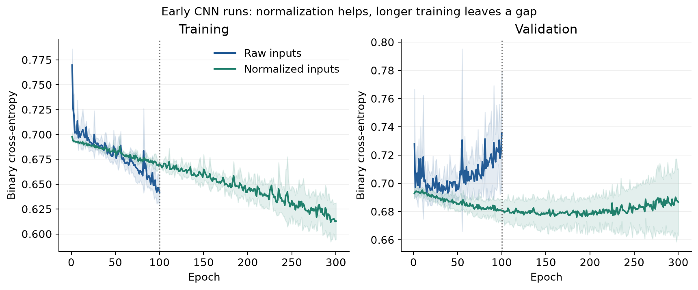
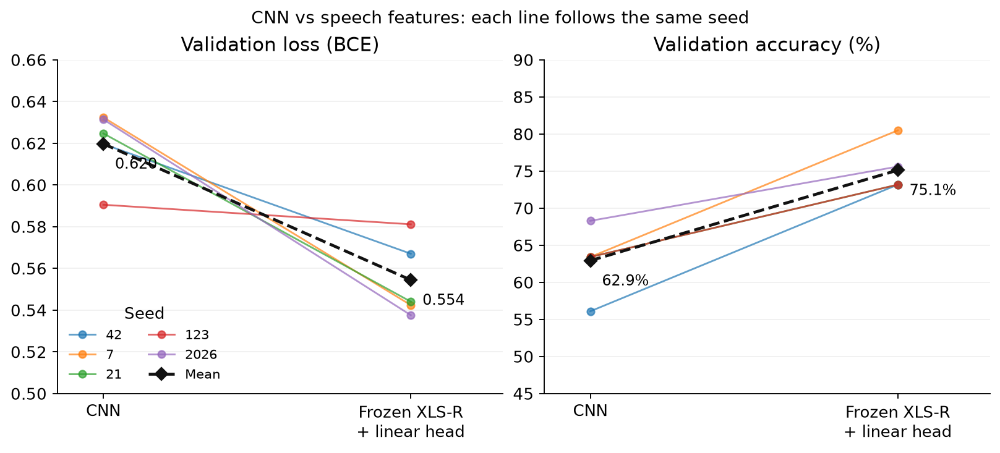

# Classification experiments

[Back to the project log](../README.md)

The task: does a one-second clip contain a configured target word?

## First: get the CNN working

I built the log-mel features, dataset loader, small CNN, and training loop. After the tiny-subset check, I tried longer runs and compared seeds.

*189 training clips / 37 recordings; 41 validation clips / 8 other recordings. Mean and shaded sample SD across five seeds. Adam, learning rate 0.001, batch size 16.*

- I kept training-only normalization. Compare the first 100 epochs for an equal-budget view.
- Continuing to 300 epochs lowered training loss, but validation flattened and later rose. Longer training didn't remove the gap.
- Weight decay at `1e-4` and frequency masking up to 8 bands didn't give a consistent improvement in their separate trials. I kept zero decay and masking disabled.

## More data, then speech features

I expanded the dataset and checked reviewed-only versus mixed-label training. Mixed labels helped validation loss, but accuracy varied by seed. That didn't settle whether the remaining errors came from labels or the representation.

Next I cached features from frozen XLS-R-300M and trained a linear head on their time averages.

*1,297 training clips / 449 recordings; the same 41 validation clips / 8 recordings. Five seeds, 24,600 Adam updates each, batch size 16, learning rate 0.001, threshold 0.5. Training-only normalization; checkpoints selected by lowest validation BCE. Equal updates are not equal compute.*

- Mean accuracy: **62.9% → 75.1%**. Loss and accuracy improved in every paired seed.
- A later family-balanced loss improved average family recall but worsened overall validation loss. I kept the unweighted head.
- These are repeatedly used validation results, not independent test performance. Seed variation doesn't measure uncertainty on new songs.

Next I tried preserving timing information with four ordered pooling bins. The current comparison is in the [project log](../README.md#four-ordered-bins).

## Check the figures

[Loss histories](../evidence/early_cnn_history.csv) · [Per-seed classifier results](../evidence/representation_metrics.csv) · [Settings](../evidence/protocol.json)

The [plotting script](../scripts/render_figures.py) redraws both figures. These files reproduce summaries, not training. The test set was not evaluated in these comparisons.
