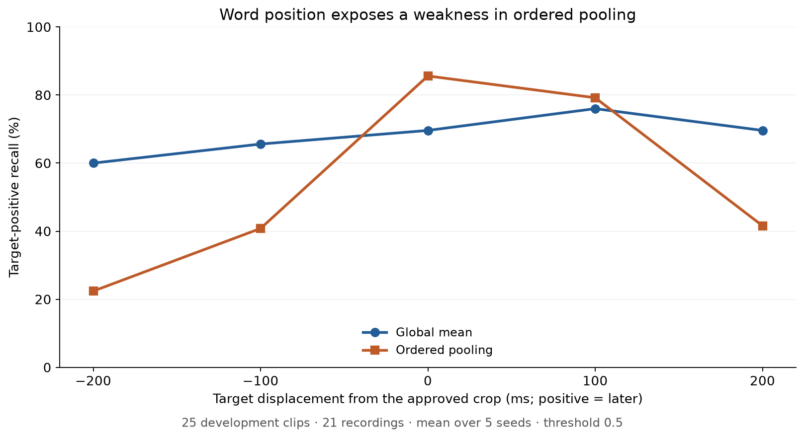

# When the word moves inside the window

[Back to the project log](../README.md)

Global averaging gives the classifier a summary of the whole clip. I wanted to see whether preserving some timing information would help distinguish target words from similar sounds.

## Four ordered bins

I divided the frozen speech encoder's frame sequence into four consecutive groups and averaged each group separately. Concatenating those averages gives the linear head a coarse beginning-to-end representation. The encoder remained frozen.

This also makes the head larger. The experiment changes both temporal information and classifier capacity, so any improvement cannot be attributed to word order alone.

The training set had expanded to 1,428 clips from 487 recordings. The original 41-clip validation set still selected checkpoints. A 70-clip development panel from 26 recordings was used to inspect the selected models; it had already informed development and was not an independent test.

| Representation | Mean accuracy on the centered development panel |
|---|---:|
| Global averaging | 68.9% |
| Four ordered bins | 79.7% |

These are five-seed means with the same 24,600-update budget. They are not directly comparable to the earlier CNN-versus-speech table because the training data and reporting panel changed.

## Moving the target

Most examples placed the target near the middle of a one-second crop. A full-song detector would encounter it at many positions. I tested this by moving the crop boundaries in the source audio while retaining the complete target with a margin.

The comparison used the same 25 eligible positive clips from 21 recordings at all five offsets. Checkpoints were not reselected on shifted examples. An offset of -200 ms means the target appears 200 ms earlier within the new window.

| Model | Target 200 ms earlier | Original position | Target 200 ms later |
|---|---:|---:|---:|
| Global averaging | 60.0% | 69.6% | 69.6% |
| Ordered pooling | 22.4% | 85.6% | 41.6% |

Values are mean recall across five seeds on the same positives.

The centered result had hidden a large weakness: the ordered model missed many targets when their position changed. This is consistent with dependence on absolute position, but it does not prove the model ignored the word's sound. Recropping also changes the surrounding audio, and the boundaries used to select valid crops are approximate.

## Next: train with shifted examples

Try sampling eligible shifted crops during training, keeping the target inside the window. Match the optimizer-update budget and keep checkpoint selection on the original validation set. Then check both centered and shifted inputs for regressions.

This positive-only diagnostic measures recall, not false alarms or full-song detection quality.

The [position counts](../evidence/position_counts.csv), [centered-panel results](../evidence/centered_metrics.csv), and [protocol](../evidence/protocol.json) support these numbers. The [checking script](../scripts/reproduce_results.py) recomputes them; the [plotting script](../scripts/render_figures.py) redraws the figure. Neither reproduces private audio preparation or training.
